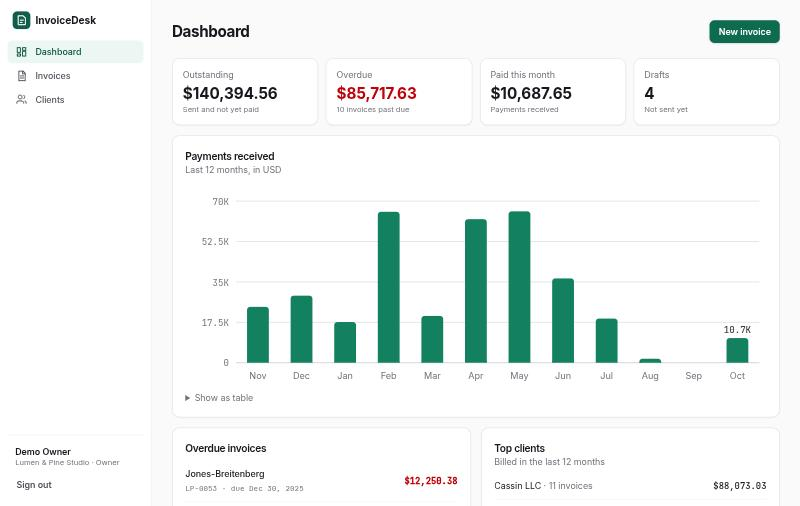
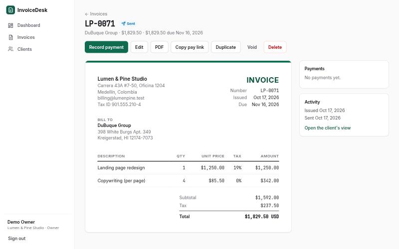
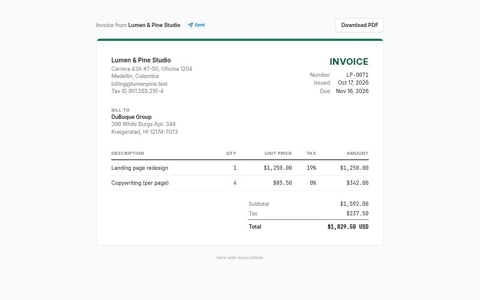

# InvoiceDesk

[](https://github.com/JoseMayo16/invoice-desk/actions/workflows/ci.yml)

**Invoicing for freelancers and small studios: clients, invoices, PDF, email and card payments.**

A Laravel 13 API with a Vue 3 + TypeScript single-page app. Create an invoice, email it with
the PDF attached, let the customer pay it by card through Stripe Checkout, and watch the
dashboard update when the payment webhook arrives.



| Invoice (team view) | What the customer sees |
|---|---|
|  |  |

## Features

- **Invoices** with any number of lines, per-line tax, automatic numbering (`LP-0001`, ...),
  drafts, sending, duplicating, voiding, partial payments and a derived *overdue* state.
- **PDF** for every invoice (dompdf) and **email** with the PDF attached, sent through the queue.
- **Customer page** at an unguessable link: view, download the PDF, **pay by card** with Stripe
  Checkout. A signed webhook records the payment and marks the invoice paid.
- **Dashboard**: outstanding and overdue amounts, payments per month for the last year, top
  clients, invoices past due.
- **Teams**: every company's data is isolated; owners can delete, members cannot.

## Engineering decisions

- **Money is integer cents.** Each line is rounded once and totals are sums of lines, so the
  PDF, the API and the database agree to the cent. The editor shows live totals with a
  TypeScript copy of the same function, and both are tested against the same cases.
- **The server computes every amount.** The client sends quantities and prices; any `total`
  in the request is ignored.
- **Company isolation in route binding.** `{invoice}` and `{client}` only resolve inside the
  signed-in user's company, so another company's record is a 404, never a 403 that confirms
  it exists. Policies add the role rules (only owners delete).
- **Cookie auth, no tokens in the browser.** Sanctum SPA authentication with CSRF protection;
  the Vue app is served from the same origin (Vite proxy in development, Laravel in production).
- **Idempotent payments.** The Stripe checkout session id is unique on `payments`, so a
  re-delivered webhook cannot pay an invoice twice. Unsigned or tampered webhooks get a 400.
- **Stripe is optional.** Without keys the app works fully and simply hides card payments.
  The gateway sits behind an interface, which is also how the tests fake it.
- **Invoice numbers can't collide.** The next number is reserved under a row lock.

## Stack

| | |
|---|---|
| API | Laravel 13, PHP 8.4+, Sanctum, Form Requests, API Resources, Policies, queued Mailables, dompdf, stripe-php |
| App | Vue 3 (Composition API, `<script setup>`), TypeScript, Vue Router, Pinia, Tailwind CSS 4, Vite |
| Data | SQLite for development and tests; standard migrations for MySQL or PostgreSQL |
| Quality | PHPUnit feature and unit tests, Vitest, Pint, vue-tsc, GitHub Actions |

## Run it locally

Requirements: PHP 8.4+ with `pdo_sqlite`, `iconv` and `mbstring`; Composer; Node 24+.

```bash
# API
cd backend
composer install
cp .env.example .env && php artisan key:generate
php artisan migrate --seed          # demo company with a year of invoices
php artisan serve                   # http://127.0.0.1:8000
php artisan queue:work              # in a second terminal: sends the emails

# App
cd frontend
npm install
npm run dev                         # http://localhost:5173
```

Sign in with **owner@demo.test** or **member@demo.test**, password `password` (buttons on the
login page). Emails go to `storage/logs/laravel.log` unless you point `MAIL_*` at a real server
or at Mailpit.

### Card payments (optional)

1. Put your Stripe **test** keys in `backend/.env`: `STRIPE_SECRET=sk_test_...`.
2. Forward webhooks with the Stripe CLI and copy the `whsec_...` it prints into
   `STRIPE_WEBHOOK_SECRET`:
   ```bash
   stripe listen --forward-to localhost:8000/api/stripe/webhook
   ```
3. Send an invoice, open its pay link and use the test card `4242 4242 4242 4242`.

### Production build

`npm run build` in `frontend/` writes the app to `backend/public/app`; Laravel then serves it
for every non-API path, so one server runs everything.

## Tests

```bash
cd backend && php artisan test && vendor/bin/pint --test
cd frontend && npx vitest run && npm run build
```

The API tests cover authentication, company isolation on every endpoint, roles, validation,
totals and numbering, status filters (including overdue), sending with a queued email, manual
and partial payments, the public page, Stripe checkout with a fake gateway, webhook signatures
and idempotency, the dashboard numbers, and the PDF and email rendering.

## API

| Method | Path | |
|---|---|---|
| POST | `/api/register`, `/api/login`, `/api/logout` | session auth (call `/sanctum/csrf-cookie` first) |
| GET | `/api/me`, `/api/dashboard` | |
| GET POST PUT DELETE | `/api/clients`, `/api/invoices` | `?q=`, `?status=draft\|sent\|overdue\|paid\|void`, `?client_id=` |
| POST | `/api/invoices/{id}/send`, `/duplicate`, `/void`, `/payments` | |
| GET | `/api/invoices/{id}/pdf` | |
| GET POST | `/api/public/invoices/{token}`, `/pdf`, `/checkout` | no auth, for the customer |
| POST | `/api/stripe/webhook` | Stripe-signed |

## License

MIT. Demo data is generated: every company, person and address is invented.
